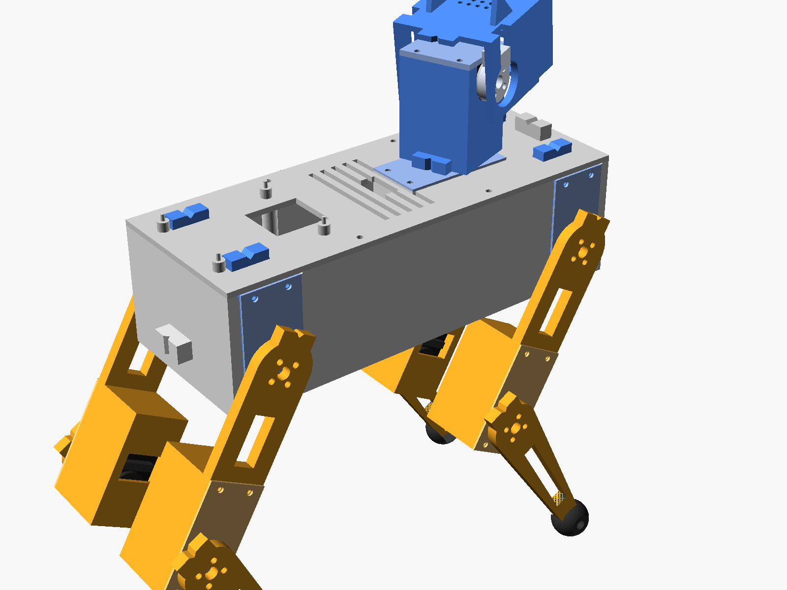
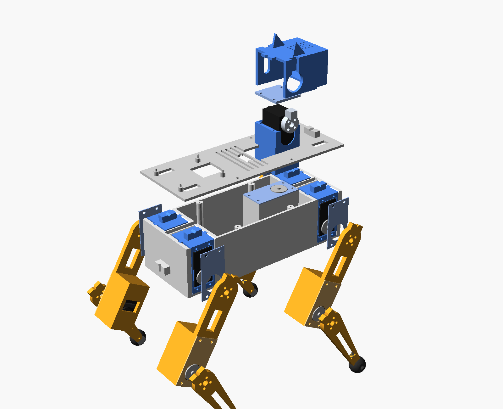

# Pip: a 3D-printed AI robot dog, designed to be easy to assemble

A small four-legged robot dog (about 25 cm long, ~1.9 kg) that you print on a **Bambu Lab P2S** and run on a **Raspberry Pi 5**.

- **Moving head:** pans and tilts, with a camera, distance sensor, speaker and mic.
- **Voice:** listens for commands offline and talks back.
- **AI:** hands harder requests to **Claude**, which plans multi-step tasks with the dog's tools and camera.

**v2 is designed so that every step is a straight-down move**, with one screw type and automatic calibration. A person with a screwdriver assembles it quickly, and a cheap machine could do it later. Every change is checked in a **physics simulation** before printing.

## What's here

| Path | What |
|---|---|
| [`cad/`](cad) | Parametric OpenSCAD design: `params.scad`, `lib.scad`, `assembly.scad`. [`cad/stl/`](cad/stl) has print-ready STLs (no supports, no inserts) plus the leg jig. |
| [`software/`](software) | Python stack: kinematics, trot gait, bus-servo driver, head, vision, navigation, voice, Claude brain, calibration. 57 tests. |
| [`sim/`](sim) | MuJoCo simulation built from the CAD and driven by the real controller. Results and video in [`sim/results/`](sim/results). |
| [`docs/ASSEMBLY_FIRST_DESIGN.md`](docs/ASSEMBLY_FIRST_DESIGN.md) | Why it's built this way: precedent, design rules, the cheap assembly-tool ladder |
| [`docs/SIMULATION.md`](docs/SIMULATION.md) | What the sim found and what changed because of it |
| [`docs/BOM.md`](docs/BOM.md) · [`PRINTING.md`](docs/PRINTING.md) · [`WIRING.md`](docs/WIRING.md) · [`ASSEMBLY.md`](docs/ASSEMBLY.md) · [`SOFTWARE.md`](docs/SOFTWARE.md) | Build guides |

## How the design makes assembly easy

- **4 identical leg modules.** The left side uses the same module turned 180°. Each is built straight down in a printed jig, then drops into a tray socket.
- **Smart bus servos (Feetech STS3215).** They're daisy-chained, and their encoders give **automatic calibration**: the jig holds the leg straight, and one command records the zeros.
- **One standard servo cup and one cap** hold all 10 servos.
- **One fastener: M3 × 8.** No heat-set inserts.
- **Each part is held by the next one.** The deck traps the legs. The head drops onto a keyed hub.
- **Chamfered lead-ins** on every mating edge, and **grip lugs** with a datum notch on the main parts.

## Simulation highlights ([details](docs/SIMULATION.md))

Using the real control code against a model built from the CAD:

- Walks at **100–200 mm/s within 2 %** of the commanded speed, with **≤ 2° roll**.
- Turns in place at **45°/s**, backs up, holds every pose, and moves the head while walking. **No falls** in the 53 s test.
- Things the sim caught and fixed before any printing:
  - a wobbly gait
  - a robot that couldn't turn
  - a fall on a walking turn
  - a forward creep
  - a stop bug
  - a knee/tray collision limit
- **Warning:** the knee servos run close to their continuous torque rating while walking. Expect warm servos on long walks.

## The plan

1. **Order parts** ([BOM.md](docs/BOM.md)). The servos are half the cost. Buy the **12 V** STS3215.
2. **While you wait:** run the sim (`pip install -e "software[sim]" && python sim/run_sim.py --quick`) and the software (`python -m robodog --sim --local`).
3. **Print the test-fit pair** ([PRINTING.md §1](docs/PRINTING.md)), then the rest: about 27 h, two 1 kg spools of PETG.
4. **Set servo IDs, build the legs in the jig, calibrate, stack the body** ([ASSEMBLY.md](docs/ASSEMBLY.md)).
5. **First walk** with typed commands, then calibrate drift and turning on your floor, then turn on voice and Claude.

## Specs

| | |
|---|---|
| Degrees of freedom | 8 legs (hip pitch + knee) + 2 head (pan, tilt) |
| Actuators | 10 × Feetech STS3215 12 V bus servos (30 kg·cm stall) |
| Legs | 100 mm + 100 mm, 170 mm standing hip height |
| Compute | Raspberry Pi 5 (8 GB) |
| Sensors | Camera Module 3, VL53L1X time-of-flight (both in the head) |
| Voice | Vosk (offline speech-to-text) + Piper (offline text-to-speech), wake word "Hey Pip" |
| AI | Claude via the Anthropic API (tool use + vision), with an offline keyword fallback |
| Power | 3S2P Li-ion pack with BMS → servos directly, 5 V buck → Pi. Sim estimate: about 1–2 h. |

v1 (12 PWM servos with hip roll) is in the git history at commit `9178ef9`.

MIT licensed.
