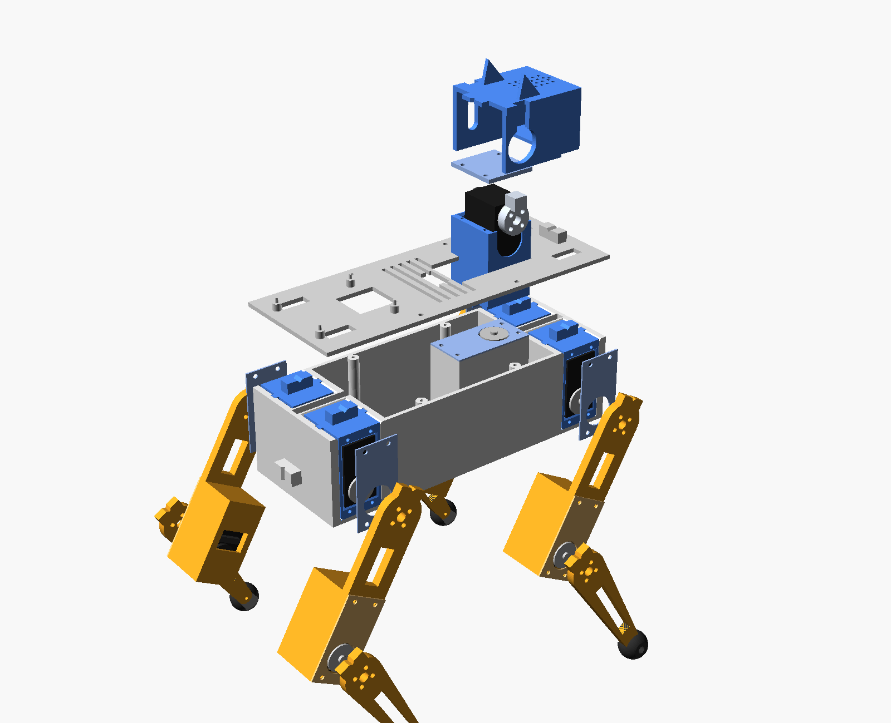
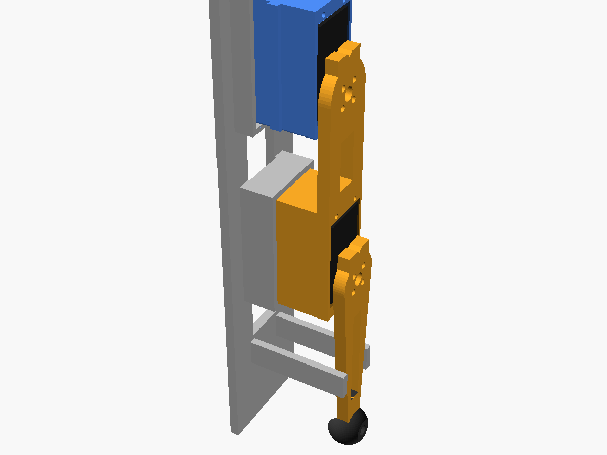

# Assembly (v2): every step is a straight-down move



The design follows [ASSEMBLY_FIRST_DESIGN.md](ASSEMBLY_FIRST_DESIGN.md):

- Every part goes on **from above**, guided into place by chamfers and keys.
- It's held by the part that goes on next.
- There is **one screw: M3 × 8**.
- Each servo's zero is **read from its encoder**, so a horn can go on at any spline tooth.

Order these steps so a future gantry or arm could do them. For now, you plus an electric screwdriver.

Tools: a 2.5 mm hex bit on an electric screwdriver, the printed **leg jig**, and a laptop or the Pi with the bus adapter.

## 0. Servo prep (all 10 servos)

1. Connect **one** servo at a time to the bus adapter and run `python -m robodog.calibrate --set-id N`, with N from [WIRING.md](WIRING.md). Label the servo.
2. Fit each disc horn and its center screw (supplied). **Any tooth is fine.**
3. Tilt servo (ID 10) only: screw the **tilt hub** onto its horn (4 × M3 × 8). When the head goes on later, the key has to point straight up: use `--jog 10` to set that.

## 1. Leg module (× 4, identical), built in the leg jig, outboard side up



1. **Hip block** into the jig's top pocket, cup open upward.
2. **Pitch servo** (shaft up) drops into the cup. Its connector side goes in first.
3. **Servo cap** over it: 4 screws.
4. **Upper link** onto the pitch horn, cup end toward the knee end of the jig. The geared servo is too stiff to turn by hand, so let it turn itself: `python -m robodog.calibrate --jog 1` (keys a/d nudge ±2°, q quits) until the horn's 4 holes line up with the link. Then 4 screws.
5. **Knee servo** (shaft up) drops into the upper link's cup, then a **cap** (4 screws).
6. **Lower link** onto the knee horn, tip into the jig's fence: 4 screws.
7. **Foot** (TPU) pushes down onto the tip: 1 screw.
8. Plug the chain cable (pitch → knee) and the dock pigtail.
9. **Calibrate while it's in the jig.** The jig holds the leg exactly straight (pitch 0°, knee 0°). Connect the module to the bus and run:
   ```bash
   python -m robodog.calibrate --jig FR      # then FL, RR, RL for the other modules
   ```
   This records each joint's encoder zero into `software/calibration.yaml`. That's the whole calibration.

## 2. Body

1. **Pan servo** (ID 9, shaft up) drops into the cup built into the tray, then a **cap** (4 screws).
2. Battery into the tray's rear bay, strapped through the floor slots. Bus adapter, 5 V buck, fuse and harness go on top of it.
3. Pogo connector blocks into the four socket pockets (optional, see [WIRING.md](WIRING.md)).

## 3. Legs into the body

Drop each leg module **straight down** into its corner socket. Tongues and grooves plus the chamfered socket mouth guide it in.

- **Right-side sockets:** the module as built in the jig.
- **Left-side sockets:** the same module turned 180°.

## 4. Deck

Lower the deck: the grip lugs on the hip blocks poke through its slots and locate it. Drive 4 screws into the tray bosses. **The deck is what traps the legs**, so to swap a leg you remove the deck. Drop the Pi 5 (with cooler) onto the four pins.

## 5. Neck and head

1. **Pan bracket** onto the pan horn: 4 screws.
2. **Tilt servo with its hub** slides **down** into the bracket's sleeve. The horn and hub ride down the U-slot.
3. **Sleeve cap**: 4 screws.
4. Put the camera, ToF sensor, speaker and mic into the **head** first, then drop the head **straight down**: the key goes into the right-hand slot and the pin into the left-hand slot. It clicks over the key.
5. With the head looking straight ahead, run `python -m robodog.calibrate --head`.

## 6. Check and go

```bash
python -m robodog.calibrate --scan            # expect IDs 1-10
python -m robodog.calibrate --test FR.pitch   # the knee should move BACKWARD; if not, set servos.positive_dir: -1
python -m robodog --text --local              # "stand up", "walk forward 30 cm", "turn left", "look left"
```

Before you rely on the walk speed, calibrate `gait_drift_comp_mm_s` and `yaw_stride_gain` on your floor ([SIMULATION.md](SIMULATION.md#calibrating-the-sim-numbers-on-the-real-robot)).

## Hand-only steps (for now)

These are what a cheap gantry or arm can't do (see the design doc):

- plugging the 8 chain/dock cables
- fitting the horn center screws
- routing the head cables
- the battery

Everything else is a straight-down place, press or screw.
