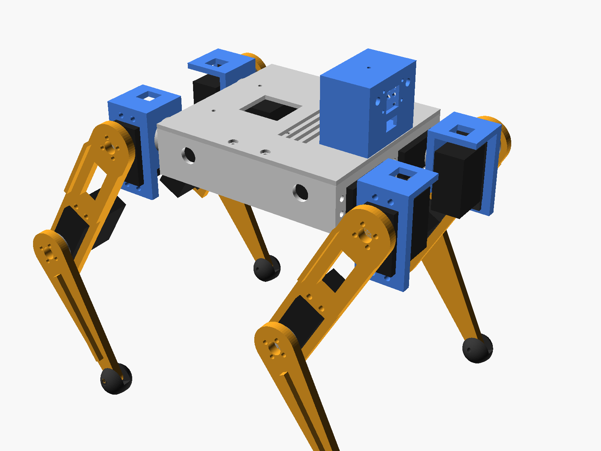

# Assembly



Open [`cad/assembly.scad`](../cad/assembly.scad) in OpenSCAD to spin the model around. Change `pitch`/`knee`/`roll` at the top to see the joints move.

**Naming:** **roll** servos sit in the chassis and swing a leg sideways. **Pitch** servos sit in the hip housings and swing the leg forward and back. **Knee** servos sit in the upper legs. Leg codes: FR, FL, RR, RL (front/rear, right/left).

## 0. Software and electronics first (on the bench)

1. Flash **Raspberry Pi OS (64-bit)** with Raspberry Pi Imager. In the Imager settings, turn on SSH and Wi-Fi.
2. Clone this repo on the Pi and run `bash software/scripts/setup_pi.sh`, then reboot.
3. Wire the electronics on the table ([WIRING.md](WIRING.md)), with all 12 servos plugged in and **no horns on yet**.
4. Run:
   ```bash
   cd software && .venv/bin/python -m robodog.calibrate --center
   ```
   Every servo moves to its mid-point. **Leave the power on** while you fit the horns, so the servos stay centred.

## 1. Chassis and roll servos

1. Drop each roll servo into the chassis tub, shaft end toward the nearest front or rear wall, and slide it forward through the wall window until the ears sit flat on the wall's inside face.
2. Screw the ears in with M3 × 10 into the inserts (4 per servo).

## 2. Hip housings

1. Press a disc horn onto each roll servo spline and tighten the centre screw.
2. Bolt the hip housing to the horn (M3 × 8). The **pitch servo window should sit vertically, beside the body**, as in the render. Use `hip_housing` on FR and RL and `hip_housing_mirrored` on FL and RR.
3. Slide the pitch servo in from the inboard side, shaft pointing **outward**, and screw its ears down.

## 3. Upper legs (pose: knee 30° back)

1. Fit a disc horn on each pitch servo.
2. Bolt the upper leg on (M3 × 10) so it tilts about **30° from vertical with the knee end pointing backward** on all four legs. The spline only goes in 14.4° steps, so pick the closest tooth. Calibration trims the rest.
3. Push the knee servo through the window at the bottom of the upper leg, from the flat (inboard) side, shaft pointing outward, and screw it down.

## 4. Lower legs and feet (pose: foot under the hip)

1. Fit a horn on each knee servo and bolt the lower leg on so the **foot sits roughly straight under the hip**. That is about 60° between the upper and lower leg.
2. Slide a TPU foot onto each leg tip and cross-bolt it (M3 × 25 + nyloc).

## 5. Electronics into the body

1. Put the PCA9685, buck converters, Wago nuts and fuse in the centre bay. Double-sided foam tape is fine.
2. Run the leg cables in through the side holes with slack loops at every joint.
3. Strap the battery under the chassis.
4. Mount the Pi on the lid with standoffs, screw the head on, and connect the camera ribbon.
5. Screw the lid down (4 × M3 × 10).

## 6. Calibrate

Lift the dog so its feet are in the air: rest the body on a mug or box.

```bash
cd software && .venv/bin/python -m robodog.calibrate
```

For each of the 12 joints:

- Press **t** to wiggle the joint +20°. It should move the foot **outward** (roll), the knee **backward** (pitch), or **straighten** the leg (knee). If it moves the wrong way, press **f** to flip the direction.
- Use **a / d** (±1°) and **A / D** (±5°) to trim it into the exact stand pose. The hip housing should be level, the upper leg 30° back, and the foot under the hip.
- Press **n** for the next joint, **s** to save (writes `software/calibration.yaml`), and **q** to quit.

## 7. First steps

```bash
cd software && .venv/bin/python -m robodog --text --local
```

Type `stand up`, then `walk forward 20 cm`, `turn left`, `sit`. Keep a hand near it the first time.

If it stumbles, lower `motion.max_speed_mm_s`, raise `motion.step_height` a little, or raise `gait_period_s` in `config.yaml`.
