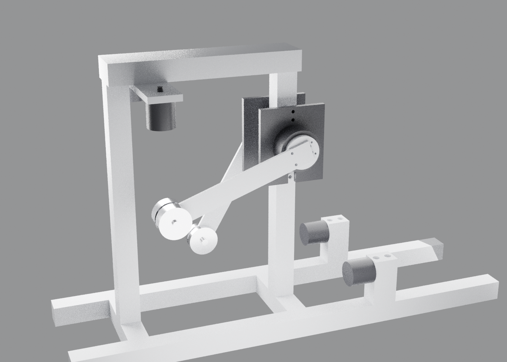

# M1 Step-1 rig: the lever stand, its software profile, and the Step 1a / 1b procedures

**Why this exists (Fable review 2026-11-28, Critical C1).** The Step-1 rig was a 300 mm bar "bolted straight to the GIM output", with no stops, no guard and no CAD. The software described a different machine. Every Step-1 tool ran the **arm**: the yaw stage at `ratio: 2.0`, the ±155° yaw stops, the forearm as the gravity model. On the real rig that doubles every angle and speed at the lever and halves every torque the supervisor believes in. The "2 kg at 0.3 m ≈ 59 %" soak becomes **118 % of rated on the bare motor**, and calibration seeks stops that don't exist. This document covers three things:

1. the rig, drawn in CAD;
2. the software that now describes it;
3. the Step 1a (no safety board) and Step 1b (loaded) procedures, with their pass criteria.

**Sources of truth:**

| What | Where |
|---|---|
| The rig profile: the single source for the software and the CAD | [sw/config/rig_step1.yaml](../sw/config/rig_step1.yaml) |
| Software model and sizing | [sw/rig.py](../sw/rig.py) (`python -m sw.rig`) |
| CAD and checks | [rnd/parts/rig.py](../rnd/parts/rig.py) (`python -m rnd.parts.rig [--render]` writes rnd/out/rig/: STEP for the cut parts, STL for the printed ones, `rig_check.json`) |
| Step 1a tool | [sw/rig_1a.py](../sw/rig_1a.py) |

Kit and go/no-go: [M1_BENCH_ARM.md](M1_BENCH_ARM.md), [M1_READINESS.md](M1_READINESS.md).

*The guard is removed in this render. The GIM6010-8 lever is in front at 70° with the soak discs; the DM-J4310 lever is behind at 30°. Both levers swing +θ toward +X, which is the leg side, on the left of this view. Upper rubber stops at +100° hang under the crossbar; the lower (reference) stops at −15° sit on the side rails, front right.*

## 1. The rig

| | |
|---|---|
| Motors | GIM6010-8 (`yaw`) on the +Y face of a centre post, DM-J4310 (`wpitch`) on the −Y face, back to back. Axes horizontal at **370 mm** above the bench. Each motor sits on a 10 mm 6061 plate stood off the post by 20 mm, held by 4 × M6 with Ø12 × 20 spacers into the post's slot; the gap gives room for the rear connectors. The motor is held by its housing holes, drilled to the measured pattern. Seller question 6 says which face carries them; if it is the output face, the plate is re-drilled with the motor reversed and a Ø44 clearance for the output. |
| Levers | A 6061 hub disc, Ø64 × 10, on each output (8 × M3 × 10, Loctite 243). The kit's 300 × 40 × 6 bar is bolted to it with 4 × M5; the axis is 15 mm from the bar's end. Lever planes are at y = +103 (GIM) and −109 (DM). |
| Weights | Bolted **through** the bar at **r = 270 mm**: an M8 × 65 8.8 bolt with a nyloc. It clamps two Ø60 × 3 steel plates (the "carrier", 0.168 kg with the bolt, always on) and Ø60 × 10 S235 discs (0.2175 kg each), in pairs, one each side of the bar. Nothing hangs or can slide off. Weigh every part to ±1 g on a kitchen scale: the torque-constant fit uses these masses. |
| Hard stops | Natural-rubber buffers (60 Sh A, Ø50 × 50, type D, M10 stud) that the **disc rim** strikes at the weight radius. The bar never touches them (CAD check). The **reference stop is at −15°**, just past hanging, on 6061 blocks on the side rails. The **span stop is at +100°**, under the crossbar. Software range is −10° … +90°. |
| Stand | An H base: two 40×40 side rails, 900 mm, directly under the lever planes, so a lower-stop hit pushes along a rail and puts no torsion on a joint. Two 40×40 cross members (172 mm), a 469 mm centre post and leg, and a 40×80 crossbar (360 mm). Joints are M8 core-bore screws plus corner brackets. The −X rail ends reach 200 mm past the guard and carry the two bench clamps. |
| Guard | A lift-off five-sided box of **3 mm polycarbonate** on printed PETG edge clips and corners (M4 heat-set inserts, M4 × 8 button heads). Inner size −240 … +380 (x) × ±178 (y) × 597 (z) mm; outer 626 × 362 × 600 mm; 1.39 m² of sheet. It is ≥ 40 mm outside every swept part. The side rails pass through 44 × 42 notches (≤ 2 mm gap). Cables leave through a 15 × 60 mm slot in the top, 149 mm above the swept volume (ISO 13857 Table 4: a 12–20 mm slot needs ≥ 120 mm). A **magnetic safety switch** sits on a printed riser on the crossbar, with its actuator under the lid, and is wired in series with the e-stop mushrooms. Lifting the box opens the contactor. |
| Step-1a fixtures | **Index disc**: printed Ø90 dial with a pointer, on the hub. **Stall arm**: printed, 130 mm, luggage-scale hook at r = 100 mm. **Tilt mandrel**: turned 6061, Ø50 flange on the output's 8 × M3, Ø25 boss, Ø12 end for a 6001-2RS loading bearing at 97 mm. |

**CAD checks** (`python -m rnd.parts.rig`, all pass):

- Each lever with the soak discs, swept across the whole range in 7.5° steps, intersects no frame part, plate, motor, stop or guard.
- At ±1° around each stop angle, the weights are clear before the stop and touch the bumper past it. The bar stays clear of the bumpers.
- Guard clearances: 44 / 40 mm in y, ≥ 66 mm in x, 149 mm at the top.
- Printed parts are ≤ 130 mm (the P2S limit is 256 mm).
- The disc clears the bench by 70 mm and the side rails by 30 mm when hanging.

### Loads and the soak sizing (`python -m sw.rig`)

On the rig the joints keep their arm names, so the CAN IDs, serials and protocol tables carry over: `yaw` is the bare GIM6010-8 (rated 5 N·m, peak 11 N·m) and `wpitch` is the DM-J4310 (3 / 7 N·m). Gravity torque is quoted with the lever horizontal.

| Session load | Discs (GIM / DM) | GIM torque | DM torque | Calibration torque GIM / DM |
|---|---|---|---|---|
| `bringup`: calibrate with span check, jog, gravity, sag test, sysid | 0 / 0 (bar + carrier) | 0.70 N·m (14 %) | 0.70 N·m (23 %) | 1.48 N·m (30 %) / 1.28 N·m (43 %) |
| `soak` (2 h) | 4 / 2 | **3.01 N·m (60 %)**; 1.04 kg at the bolt | **1.86 N·m (62 %)**; 0.60 kg | 1.59 N·m (32 %) / 0.97 N·m (32 %), no span check |

- **The soak's RMS torque** comes from the 0.25 Hz ±15° sine around the most-loaded angle in range. Sizing gives **55 % (GIM) and 57 % (DM) of rated**, inside the intended 50–60 %. The virtual soak measured **52 % / 51 %**. The soak now **fails** if a joint's measured RMS leaves 45–65 % (`load_band`).
- **Fable's numbers:** the old 2 kg at 0.3 m was 118 %, and 0.85 kg at 0.3 m was the 50 % point. Here the GIM lever carries 1.04 kg at 0.27 m plus the bar.
- **Why −15° is the reference stop:** gravity at −15° is only 0.18 N·m with the bring-up load and 0.78 / 0.48 N·m with the soak load. So calibration stays under the 60 % cap with **any** load on, which matters because the GIM may lose its zero every time the guard is lifted (see §4). Against a ±100° stop, calibrating with the soak discs on would need ≈ 95 % of rated and fails the stiff-stop check.
- **The span check** runs from −15° to +100°, i.e. 115°. It is only done in the light `bringup` session. A wrong ratio shows as a span error: the arm's 2.0 reads 57°. The rig's map check also rejects ratio 2.0 at `enumerate`.

### Stop energies and loads

All cases use the soak load, the larger inertia (J = 0.083 / 0.050 kg·m²). The bumper stiffness of 180 kN/m is an ESTIMATE: measure it (§3, 1b-0). A runaway's energy is capped by the motor's no-load speed (420 / 200 rpm).

| Case | GIM energy · bumper · force | DM energy · bumper · force |
|---|---|---|
| Calibration seek, 0.3 rad/s | 0.004 J · 0.2 mm · 37 N | 0.002 J · 0.2 mm · 28 N |
| Jog (1.26 rad/s) | 0.07 J · 0.9 mm · 0.15 kN | 0.04 J · 0.7 mm · 0.12 kN |
| Supervisor speed fault (4 rad/s): **the design case** | 0.66 J · 2.7 mm · 0.49 kN | 0.40 J · 2.1 mm · 0.38 kN |
| Runaway up at the flash limit, −10° → +100° | 6.1 J · 8.2 mm · 1.48 kN | 3.6 J · 6.3 mm · 1.14 kN |
| Runaway down at the flash limit, +90° → −15° (gravity helps) | 12.1 J · 11.6 mm (23 %) · 2.08 kN | 7.3 J · 9.0 mm · 1.62 kN |
| Runaway down at the peak torque (flash limit **not** enforced) | 23.1 J · 16.0 mm (32 %) · 2.88 kN | 10.9 J · 11.0 mm · 1.99 kN |

**Centre of percussion.** The stop sits at the weight radius, 0.27 m, which is the lever's centre of percussion (0.265 / 0.261 m). So a hit puts ≤ 55 / 70 N on the motor's output bearing (listed at 800 N) and almost nothing on the hub screws. The rotor's deceleration through the gear (rotor inertia × 64) plus the motor's own torque gives:

- 7.5 N·m at the design case, under the 11 N·m peak;
- 15.5 N·m for about a millisecond in the flash-limit runaway down (1.4× peak, ESTIMATE).

That runaway is the case the 1a flash-limit proof and the supervisor's speed fault exist to prevent.

**Structure** (6061-T6, Rp0.2 ≥ 240 MPa):

- **Upper stop plate**, 12 × 60, cantilevered 63 / 69 mm past the 40×80 crossbar: 65 MPa at the flash-limit runaway up (3.7×) and 110 MPa at the 11 N·m runaway up (2.5 kN, 2.2×). Its 2 × M6 T-nuts see ≤ 2.4 kN of prying.
- **Lower stop blocks**, 50 × 40 × 94, each on its own side rail with 2 × M8 into T-nuts:
  - tipping: 144 N·m (flash) and 199 N·m (peak), against ≈ 400 N·m from 2 × 8 kN T-nut preload (ESTIMATE), so 2.0× at peak;
  - slip: 2.08 / 2.88 kN against ≈ 3.2 kN of friction (1.5× / 1.1×).
- **Leg and crossbar** take the upper stop force (≤ 2.5 kN) through M8 core-bore screws (22 kN proof).
- **Static stall at a stop** at the peak torque: 41 N at the rubber.
- **Weight bolt**: about 0.1 × the stop force in shear (≤ 0.3 kN) on an M8. The weights themselves are stopped by the bumper.

Above the design case the bumper and blocks are the containment, not a no-damage stop. After any stop hit above the jog speed:

- inspect the bumpers and re-torque the T-nuts;
- re-run calibrate: the span check finds a moved stop.

The guard keeps everyone out of the swept volume in every case.

## 2. The software on the rig

| | Before (the arm) | Now (`--rig step1`) |
|---|---|---|
| CAN map | `can_map.yaml`: yaw `ratio: 2.0`, 5 motors | `rig_step1.yaml`: yaw **1.0**, wpitch 1.0, only the two Step-1 motors (same IDs and adapters). `sw.can_map.check` validates ratios against the rig, so 2.0 is rejected. |
| Joint description (the supervisor's torque bound, limits, speeds) | joints.json: yaw 10 / 22 N·m, ±150° | bare motors: yaw 5 / 11 N·m, wpitch 3 / 7 N·m, −10° … +90°, max speed 12.6 rad/s (jog 1.26 rad/s < the 4 rad/s speed fault). `Supervisor(desc=...)` |
| Calibration | yaw seeks +155°, span to −155° (stops that do not exist) | reference −15° (lower rubber stop), span to +100° (bring-up session only) |
| Twin and virtual plant | the bench arm, forearm in the arm fixture | `sw/rig.py` MuJoCo model: two pendulum levers with bar, hub, carrier and the session's discs; the four arm joints are inert placeholders the fixture holds |
| Test / soak weights | one mass at the grasp, hung mid-session | discs per lever, declared per session (`--load bringup / soak`). The operator confirms them at `enumerate`. Never changed mid-session: the guard is interlocked. |
| Torque constant | with/without a 0.5 kg test mass | `kt_method: absolute`: the ± sweeps against the weighed lever's gravity (masses ±1 g, radii from CAD) |
| Fits | `sw/config/actuators_<serial>.yaml` | `sw/config/rig_step1/…`, tagged `rig: step1` and marked "bare motor output: NOT the arm joint". The arm twin never loads them. Converting to the arm's yaw (2:1 belt) is: friction × 2 plus the stage's own, and backlash ÷ 2 plus the belt's. |
| Real hardware without saying which machine | ran the arm | **refused**: `sw.bringup` and `sw.soak` require `--rig step1` or `--rig arm` on any real bus |

**Rehearsals.** These are the regression tests in `python -m sw.test_s2`.

- **`python -m sw.rehearse_step1`** now rehearses **the lever rig**, with hidden actuator values, a USB-CAN bus and a 2 g weighing error per lever:
  - all 7 bring-up steps pass;
  - span 115.3° of 115° and zero error −0.17° / −0.20°;
  - fit vs hidden truth: Coulomb +2.3 / −1.9 %, viscous −1.6 / −1.2 %, K −0.3 / −0.5 %, backlash +9.3 / +4.9 %, latency −1.3 / −1.4 % (tolerances 10 / 15 / 2 / 20 / 15 %).
- **`python -m sw.soak --rig step1 --bus virtual`**: stable drives PASS, with RMS torque inside the band. A drive whose friction grows with temperature FAILS on Coulomb drift.
- **`python -m sw.rig_1a --bus virtual`**: all five 1a phases pass on a good simulated drive. A drive that ignores its limit, its CAN timeout or its flash save fails `stall`, `timeout` and `verify` respectively.

The arm profile (`can_map.yaml`, `joints.json`, `bringup.yaml`) is unchanged and is Step 2's; `--rig arm` selects it.

## 3. Step 1a: unloaded motor tests at 1 A (no safety board)

**What 1a is.** The GIM6010-8 (and the DM-J4310) on its rig motor plate, with only the hub and the 12 g **index disc** on the output. There is no lever and no weights, so nothing needs a stop or a guard. Power is the 10 A bench supply at **24.0 V with its current limit at 1.0 A**, through the 20 A ATO fuse and XT60. **The stop is the supply's OUTPUT-OFF button, within reach.** One gs_usb adapter on can0, 1 Mbit/s, 120 Ω at both ends.

> **The 1 A limit caps power (24 W), not stall torque.** At stall the drive can still push ≈ √(24 W / 0.35 Ω) ≈ 8 A through the windings, which is ≈ 3.9 N·m at the GIM output (resistance ESTIMATE). Keep hands off the disc whenever kp > 0 or τ_ff ≠ 0. In 1a the drive limit is set to 1.0 N·m before any torque is commanded (1a-5).

**Do the DM-J4310 first.** Its protocol table is complete, so running `sw.rig_1a --joint wpitch` proves the adapters, the wiring and the tool on hardware before the unknown GIM.

| # | What | Command / how | Pass |
|---|---|---|---|
| 1a-0 | Read the public GIM6010-8 manual (rnd/specs/actuators.yaml source 1) and send the six seller questions (M1_BENCH_ARM.md). Measure with calipers: output PCD, hole count, thread and depth; pilot Ø; flange thickness; housing-hole pattern and **which face** carries them; overall Ø × length. Set `OUT_PCD` / `HOUSING` in rnd/parts/rig.py and `MOTOR` in cartridge_m.py (lead). | manual, calipers | The numbers are recorded in docs/sw/gim_protocol_notes.md. The motor plate and hub are drilled to them. |
| 1a-1 | Identify the drive with the vendor tool over USB-C: firmware, node ID, bit rate, control modes, CAN-timeout and current-limit parameters, flash save. Set node ID 0x03 (feedback 0x13 if settable), 1 Mbit/s, MIT mode if offered. | vendor GUI | SDC104, 24 V version confirmed; 1 Mbit/s set; node ID set or recorded. |
| 1a-2 | Listen, then send a no-torque probe (the MIT exit-motor-mode frame). | `python -m sw.gim_discover --bus socketcan:can0 --id 3` | An answer on the node ID with an MIT-plausible decode. If none: **stop**. Per the repo's own rule, no further GIM is bought until resolved. |
| 1a-3 | Zero-gain motor mode while the operator turns the disc by hand, 1 full turn each way. | `… --enable` | Position follows the disc within ±2° over the turn. One turn = **2π rad: the drive reports the OUTPUT angle**; the rig's `ratio: 1.0` assumes this, so if it reports 16π (rotor) record it and set the table's scaling. \|τ\| < 0.1 N·m. Supply < 0.2 A. Leaves motor mode on DISABLE. |
| 1a-4 | Fill the GIM table from the manual, 1a-1 and 1a-2. | edit sw/drivers/gim.py; `python -m sw.drivers.gim` | No TODO left. |
| 1a-5 | Write the 1a torque limit (1.0 N·m) and the 30 ms CAN timeout, save to flash, read back. | `python -m sw.rig_1a --bus socketcan:can0 --joint yaw limits` | Both read back equal to what was written. |
| 1a-6 | Supply OFF ≥ 10 s, ON, read both back. | `… verify` | Both still equal: **the limit is in flash**. |
| 1a-7 | Impedance: kp 5 N·m/rad, kd 0.1; a +0.15 rad target ramp from where the disc sits, a 1 s hold, back, hold. Peak demand 0.75 N·m. | `… impedance` | Hold error < 0.05 rad. The reported torque matches kp·e + kd·ė (the MIT law) within 0.10 N·m (p99). No fault status. |
| 1a-8 | The drive's own CAN timeout: zero-gain frames for 0.5 s, then silence for 3 × 30 ms. | `… timeout` | The drive then reports itself disabled or timed out. This is the drive-side half of the stop chain. |
| 1a-9 | Limit at stall. Fit the **stall arm**; hook the luggage scale (on peak-hold) at 100 mm, its anchor bolted to the bench, cord square to the arm. The demand kp·(target − p) ramps 0 → 2 N·m → 0 over 4 s. It is computed **inside the drive**, so only the drive's own limit can cap it. | `… stall` (type the scale's peak reading) | Reported plateau 1.0 N·m ± 10 %. **Scale** 1.0 N·m ± 15 % (≈ 1.02 kg). Scale / reported = the first torque-constant check, 0.85–1.15. **Trust the scale, not the report:** a drive that ignores its limit still *reports* 1.0 N·m because its feedback range saturates (rehearsal). |
| 1a-10 | Encoder zero over a power cycle. Set the disc to a mark, supply OFF/ON, read the angle (gim_discover `--enable` trace or the vendor tool). | — | Record which: kept (absolute), kept modulo 45° (motor-turn absolute ÷ 8), or reset. The rig's −15° reference stop works for all three. The arm (Step 2) needs the answer for its re-zero after an e-stop. |
| 1a-11 | **GIM output tilt stiffness and bearing layout** (Fable M3): see below. | tilt mandrel, indicators, optical lever | Stiffness k_t measured with its dead band. The decision below is recorded. The pinion is quoted only after this. |
| 1a-12 | (Kit line) the CAN FD HAT against the gs_usb adapters on the same bus (docs/sw/can_interface_note.md). | sw.can_latency | As that note says. |

The 1a tool writes docs/sw/rig_1a_<date>_<joint>.md / .json. **1a is done when 1a-2 … 1a-10 pass on the GIM and 1a-5 … 1a-9 pass on the DM.** If 1a-2 or 1a-3 fails, or the SDC104 has no impedance mode, no CAN timeout or no flash limit, stop. The safety argument changes before Step 1b is bought (Fable M1).

### 1a-11: GIM output tilt stiffness (decides the D26 pinion support)

**Why.** The D26 pinion shaft has three supports: the motor's output bearing, and a bonded 6001 in wall B. belts.md passes it only if the output tilts freely ("hinged": fatigue 3.13×). If the output is moment-rigid, a 0.15 mm offset after a motor swap gives 0.56× and 110 N·m on the motor bearing.

**Fixture:**

- The GIM on its rig motor plate, on the stand, **unpowered and unplugged**.
- The **tilt mandrel** on the output (8 × M3 × 10, Loctite 222, removable): a Ø25 boss with a 6001-2RS on its Ø12 end, 97 mm from the output face.
- **Load:** a Dyneema loop around the 6001's outer ring, perpendicular to the motor axis, through the luggage scale and an M6 turnbuckle to an anchor on the stand's leg. The bearing passes the load through the axis, so there is no torque on the output.
- **Steps:** 0, 25, 50, 100, 150, 200 N and back to 0. Then repeat with the anchor moved to the opposite side (reversed load). 200 N × 0.103 m ≈ 21 N·m, below the 800 N radial listing.

**Gauges:**

- Two **0.01 mm dial indicators** on magnetic bases. The bases sit on a 6 mm steel flat bar clamped **to the motor plate**, so the reading is relative to the motor, not the bench. They read the Ø25 boss at 20 mm and 80 mm from the output face.
- A third indicator on the motor housing rim, to subtract the plate's and housing's own tilt.
- An **optical lever** for the small tilts: a 10 mm mirror glued to the mandrel's end face, a laser pointer 2.0 m away, and the spot on mm paper beside it. Tilt θ = Δspot / (2 × 2.0 m), so 1 mm of spot = 0.25 mrad (0.86′).
- Calipers.

**Analysis:**

- Tilt θ = (d₈₀ − d₂₀) / 60 mm, minus the housing's tilt. Cross-check with the optical lever.
- Moment M = F × (97 + e) mm, where e is the bearing's distance behind the output face: 6 mm ESTIMATE. Fit e from the radial deflection extrapolated to the face.
- Read off the slope k_t = ΔM / Δθ over 5–20 N·m, the **dead band** (the loop's width at zero load: internal clearance), and the radial stiffness.
- Also measure axial play: ±50 N push/pull, indicator on the end face.

**Expected readings:**

- A single deep-groove row with clearance ("hinged"): ≥ 2.5 mrad at 20 N·m, i.e. ≥ 0.15 mm differential and ≥ 10 mm of spot.
- A crossed-roller or preloaded pair (moment-rigid): 0.1–0.3 mrad, i.e. 6–18 µm and 0.4–1.2 mm of spot. This is below the dial indicators' useful resolution, so the optical lever decides.

**Decision.** The stub's own end stiffness from belts.md is 15.6 kN/mm at the 6001 over 69.1 mm, which gives 3EI/L ≈ 75 kN·m/rad (ESTIMATE). The motor bearing then carries k_t / (k_t + 75 kN·m/rad) of the clamped-bound moment.

- **k_t ≤ 8 kN·m/rad** (≤ 2.4 N·m/arcmin; ≤ 10 % of the clamped moment): hinged. Keep the D26 6001 support as drawn and quote the pinion.
- **k_t ≥ 75 kN·m/rad** (≥ 50 %): moment-rigid. Use the overhung variant (STUB_SUPPORT_RULE) and drop the 6001; the seller must confirm the output's moment rating M0 ≥ 1.5 × 98 N·m.
- **In between:** the lead re-runs `belts.support_split` with the measured k_t before anything is quoted.

## 4. Step 1b on the rig: loaded, after the safety-board gate

**Prerequisites (1b-0):**

- Step 1a passed.
- The safety board built, its checklist signed and T0–T16 passed (M1_READINESS Step-1 gate).
- Stops fitted.
- Guard on, with its **interlock wired in series with the e-stop mushrooms**.
- Bumper stiffness checked: press one bumper with a bar and the luggage scale at 300 N and measure the deflection with calipers. Expect ≈ 1.7 mm; accept 90–360 kN/m (0.8–3.3 mm) and update `k_n_per_m`.

**The weight rule.** Discs are changed **only with the guard lifted, which cuts the drives**, and therefore only between sessions. Each session declares its load (`--load`). The software calibrates against the −15° stop at the start of every session, because the GIM may have lost its zero (1a-10).

| # | Session | Command | Pass |
|---|---|---|---|
| 1b-1 | **First loaded enable**: bar and carrier only (the lightest defined load, 14 % of rated). Use the **10 A supply at 2 A**, not the SE-1000, and the drive limit from 1a, then rated. The carrier stays on so that the steel plates, not the bar's edge, meet the bumpers. | `python -m sw.bringup --rig step1 --load bringup --bus socketcan:can0,can1 --estop gpiod:gpiochip0:17:27 --joints yaw,wpitch --until calibrate` | enumerate (map, ratio 1.0, load confirmed), limits, safety (e-stop ≤ 50 ms, watchdog, drive timeout) and calibrate (span 115° ± 2 %) all PASS |
| 1b-2 | Full bring-up on the SE-1000-24 | the same, without `--until` | all 7 steps PASS, including the gravity residual ≤ 20 % of rated, the **sag test** (the drive enforces its limit under load) and sysid (friction, K, backlash, latency → sw/config/rig_step1/actuators_<serial>.yaml) |
| 1b-3 | Thermal: 30 min at rated torque, case temperature logged (thermistors) | gravity hold at the soak load near 90° | as M1_READINESS exit criterion 5 |
| 1b-4 | **Soak**: guard off; bolt 4 discs on the GIM lever and 2 on the DM; guard on | `python -m sw.soak --rig step1 --load soak --bus socketcan:can0,can1 --estop gpiod:gpiochip0:17:27 --joints yaw,wpitch --hours 2` | drift limits as before; RMS torque 45–65 % of rated; loop jitter on the Pi |

**What the rig does not cover:** the belt stage, the drive stub under belt load (that is the stub coupon), and anything Step 2.

## 5. What is new for the BOM, and what is ESTIMATE

**Lines for the BOM owner** (rnd/m1_kit.py and M1_BENCH_ARM.md; prices ESTIMATE unless noted). "1a" means needed before the motors are powered; "1b" means before the lever is loaded.

| Step | Line | Qty | ≈ $ | Replaces / note |
|---|---|---|---|---|
| 1a | Stand: 40×40 B-type slot-8 profile cut to 2 × 900, 2 × 172, 2 × 469 (2.88 m); 40×80 × 360; 10 corner brackets; M6 / M8 T-nuts and screws; 4 × M8 core-bore screws | 1 | 75 | **replaces** "Bench stand: 2 × 40×40 × 400 + brackets + 2 bench clamps" ($30); keep its 2 bench clamps (Δ +45) |
| 1a | 6061-T6 stock: 10 mm plate 300 × 150 (2 motor plates); Ø65 round bar 30 mm (2 hubs); 12 mm plate 60 × 270 (upper stop plate); 50 × 40 bar 200 mm (2 lower stop blocks) | 1 | 35 | drilled and tapped on a drill press; a lathe or printed centring ring for the hub pilot |
| 1a | Tilt mandrel, 6061-T6 turned (rnd/out/rig/tilt_mandrel.step) + 6001-2RS | 1 | 27 | quote from the STEP |
| 1a | 2 × dial indicator 0.01 mm / 10 mm + 2 magnetic bases; 6 × 50 × 300 steel flat bar | 1 | 46 | skip what the owner has |
| 1a | Optical lever: laser pointer + 10 mm mirror; M6 turnbuckle + Dyneema cord | 1 | 13 | |
| 1a | Kitchen scale 5 kg / 1 g | 1 | 12 | K from weighed masses (±1 g) |
| 1a | Fasteners: 16 × M3 × 10 12.9 (hubs), 8 × M5 × 12, 8 × M6 × 35 + 8 Ø12 × 20 spacers, 4 × M8 × 110, 2 × M8 × 65 8.8 + nylocs, 4 × M10 nuts, 60 × M4 × 8 button heads | 1 | 20 | |
| 1b | Second 6061 flat bar 40 × 6 × 300 (DM lever) | 1 | 8 | |
| 1b | Weights: 8 × Ø60 × 10 S235 discs (Ø8.5 hole) + 4 × Ø60 × 3 plates, laser-cut or saw-cut bright bar | 1 | 36 | **replaces** the "1 kg and 2 kg weights" in the test-lever line (≈ −12) |
| 1b | 4 × natural-rubber buffer 60 Sh A, Ø50 × 50, type D (one M10 stud) | 1 | 12 | |
| 1b | Polycarbonate 3 mm clear, cut: 2 × 626 × 597, 2 × 362 × 597 (2 notches each), 1 × 626 × 362 (slot) = 1.39 m² | 1 | 70 | |
| 1b | Magnetic coded safety switch, NC, with actuator | 1 | 15 | wired in series with the e-stop mushrooms (electrical owner: the safety board's e-stop input) |
| — | Category-0 catch cradle + tether ($25) | — | −25 | **move to Step 2**: the rig cannot fall (pendulum levers, stops); the cradle is for the arm |

**Net:** Step 1a +$198 (the stand line +$45 of it), Step 1b +$104 (after −$12 for the replaced weights and −$25 for the moved catch), so ≈ +$302 before contingency, ≈ +$347 with 15 %. Printed parts use the kit's filament and M4 inserts: guard clips and corners, interlock riser, index disc, stall arm.

**Still ESTIMATE:**

- the GIM output PCD, pilot and housing pattern (1a-0 sets them; the DM pattern too);
- the bumper stiffness (1b-0);
- the T-nut holding force;
- the rig actuator datasheet (friction, viscous, backlash) until 1b-2 fits it;
- the motor winding resistance behind the 1 A stall note;
- the stub end stiffness behind the 1a-11 thresholds.

The magnetic switch's sensing distance must be checked against the 5 mm riser gap.
