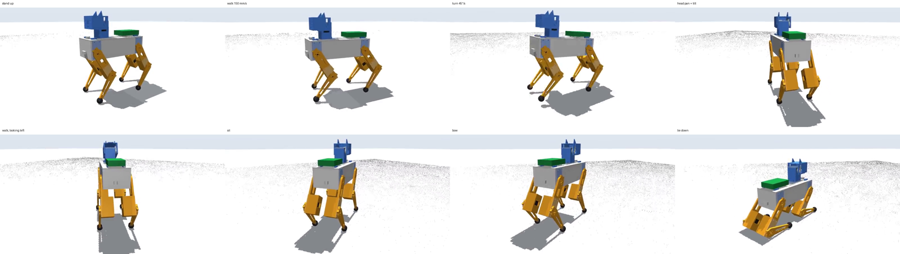

# Physics simulation (MuJoCo)

Every design change is tested here before anything is printed. The simulator is built straight from the CAD:

- **Geometry:** each printed part's mesh, exported in place by `sim/export_meshes.sh`.
- **Masses:** sliced part weights plus the bought parts, in `sim/masses.yaml`.
- **Control:** the **same `robodog` MotionController** that runs on the Pi (gait, inverse kinematics, poses, head) drives it.



Video: [`sim/results/pip_v2_sim.mp4`](../sim/results/pip_v2_sim.mp4) (53 s). Full numbers: [`sim/results/report.json`](../sim/results/report.json).

```bash
pip install -e "software[sim]"          # mujoco, trimesh, imageio
sim/export_meshes.sh                    # after any CAD change
python sim/run_sim.py                   # ~3.5 min: scenarios, sweeps, push tests, video
python sim/run_sim.py --quick           # 3 s: main scenario only, no video
```

## How the servos are modelled

Each STS3215 is a motor model stepped at 1 kHz, not an ideal joint:

- a position loop (`kp`, `kd`)
- available torque that falls linearly from stall at zero speed to nothing at no-load speed (a DC motor curve), scaled to the 11.1 V battery
- reflected rotor inertia through the gearbox, plus friction

| Parameter | Value | Source |
|---|---|---|
| Stall torque | 2.94 N·m @ 12 V (2.72 N·m @ 11.1 V) | Product listings (30 kg·cm) |
| Rated continuous torque | 0.98 N·m | Product listings (10 kg·cm) |
| No-load speed | 4.7 rad/s (~45 rpm) | **Estimate** |
| Position stiffness | 25 N·m/rad | **Estimate** |
| Reflected rotor inertia | 0.004 kg·m² | **Estimate** (1:345 gearing) |
| Robot mass | **1.94 kg** | Sliced parts + assumed bought parts |

The estimated rows are exactly why the sensitivity section below exists.

## What the simulation changed (before vs after)

| Problem found in sim | Fix | Result |
|---|---|---|
| **Wobbly walk:** 12° side-to-side roll at the original 0.40 s gait cycle | Faster gait cycle, `gait_period_s: 0.30` | Roll **≤ 1–2°** at 100–200 mm/s |
| **Couldn't turn:** 3°/s actual for 45°/s commanded. 2-motor legs have no hip roll, so feet must skid to turn. | Exaggerated turning strides, `yaw_stride_gain: 6` | **44.7°/s** for 45°/s commanded |
| **Fell over** on a walking turn | The two fixes above | No falls in any scenario |
| **Forward creep:** the trot moved +81 mm/s on its own (backward walking only reached 19% of commanded) | `gait_drift_comp_mm_s: 81` | Speed within **±2 %** forward *and* backward |
| **Bug:** after "stop", the drift compensation kept the dog trotting in place forever | Only compensate while a speed is commanded. Regression test added. | Settles to a still stand |
| **Knee collision:** the knee servo hits the tray when the hip swings back more than ~50° (found by the CAD collision check) | Joint limit `pitch ≤ 50°`. Sit, lie and bow re-shaped to keep the feet ahead of the hips. | All poses reachable |
| Balance feedback from a tilt sensor (IMU leveling) | Tried: it *added* roll and torque in the trot | Left **off**, so no IMU needed |

## Results (current design and config)

**Main scenario:** stand up, walk, stop, turn, arc, back up, head sweeps, walk while looking left, then sit, bow and lie. **No falls in any of 21 segments.**

| Test | Commanded | Achieved | Max roll | Worst-joint torque (RMS) |
|---|---|---|---|---|
| Walk | 100 mm/s | 99 mm/s | 1.1° | 0.89 N·m |
| Walk | 150 mm/s | 150 mm/s | 1.0° | 0.89 N·m |
| Walk | 200 mm/s (the configured max) | 202 mm/s | 1.0° | 0.89 N·m |
| Walk backward | −100 mm/s | −116 mm/s | 1.9° | 0.93 N·m |
| Turn in place | 45°/s | 44.7°/s | 13° | 1.16 N·m |
| Arc | 120 mm/s + 20°/s | 89 mm/s + 18°/s | 3° | 1.08 N·m |
| Head pan ±60° / tilt ±25° while standing | | Body undisturbed | 0° | 0.29 N·m |

**Push tests** (sideways shove of 0.15 s on the body):

| | 0.6 N·s | 1.2 N·s | 1.8 N·s |
|---|---|---|---|
| Standing | ✅ | ✅ | ❌ falls |
| Walking at 120 mm/s | ✅ | ❌ falls | ❌ falls |

**Sensitivity** (150 mm/s walk with different servo assumptions):

| Case | Falls? | Speed | Note |
|---|---|---|---|
| Baseline | no | 150 | |
| Slower servo (3.0 rad/s) | no | 159 | Fine |
| Weaker servo (2.0 N·m stall) | no | 154 | Fine |
| Heavier rotor (×3 inertia) | no | 222 | The drift compensation is off for this case, so **calibrate it on the real robot** |
| **Softer servo position loop** (kp 12) | no | **40** | ⚠️ The gait barely propels. **Keep the STS3215 P-gain at its default; don't lower it** (LeRobot lowers it for arms). |

## What this tells you about the hardware

1. **The STS3215 works, but with little margin.**
   - The knee servos run at about 0.9 N·m RMS while walking, close to their 0.98 N·m continuous rating. They touch stall torque about 1 % of the time and run near their top speed.
   - Expect them to get warm on long walks.
   - The servos report their own temperature (`StsBusDriver.telemetry`), so a rest-when-hot rule is an easy addition.
2. **Body weight isn't what loads the knees; swinging the legs is.** Taking 170 g off the tray changed knee torque by only 2 %. Lighter *legs* and lower swing speed matter more.
3. **Battery** (rough upper bound): about 28 W standing and 60–75 W walking or turning. With a 66 Wh 3S2P pack that's roughly **1–2 hours**.
4. **Turning in place is a skid turn,** with up to 13° roll. On slippery floors it will be faster, and on grippy rugs slower. `yaw_stride_gain` is the knob.

## Calibrating the sim numbers on the real robot

These sim-tuned values depend on your floor and your servos:

- **`gait_drift_comp_mm_s`:** command a turn with no forward speed and measure how far the dog creeps forward in 10 s. Add that speed to the current value. If it creeps backward, subtract.
- **`yaw_stride_gain`:** command 45°/s for 8 s. It should turn about 360°. Scale the gain by 360 divided by the angle it actually turned.
- **Masses:** weigh the bought parts and put the numbers in `sim/masses.yaml`, then re-run the sim.

## Limits of this simulation

- The servo speed, stiffness and rotor inertia are estimates, so read results as relative (A vs B), not absolute.
- It only models a flat, rigid floor with a single friction value of 0.9 for the TPU feet. There are no cables, no flex in the printed parts, and no backlash.
- Collisions between the robot's own parts aren't simulated. The CAD collision check (`cad/` intersection test) covers those instead.
