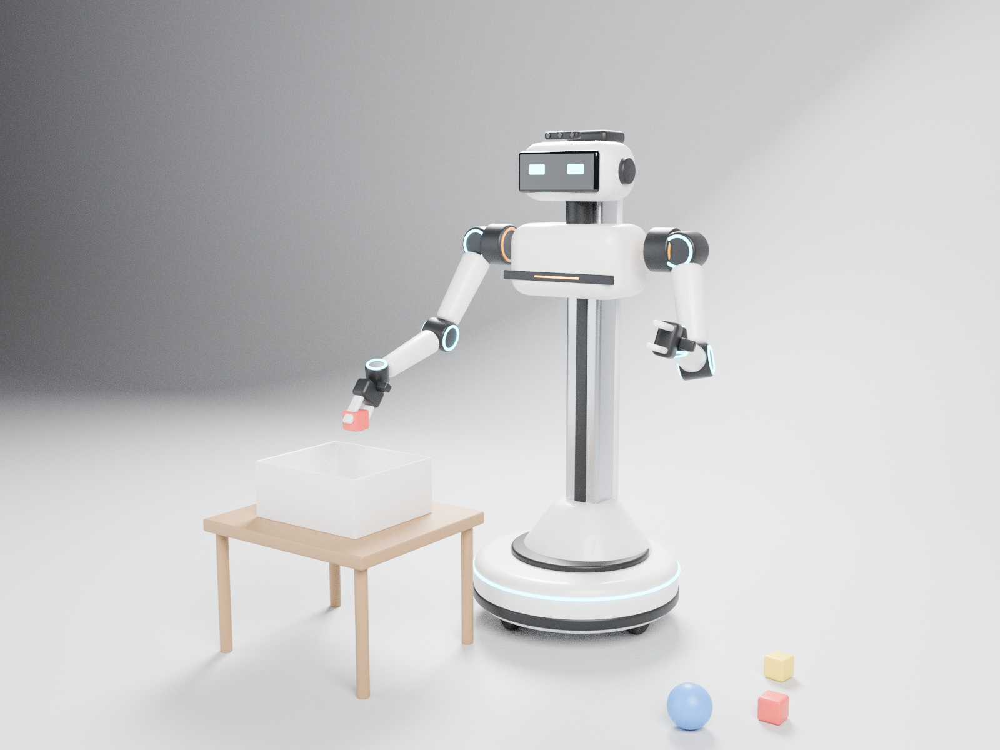

# Pip v4: a reprogrammable two-armed robot for under ~$3k, built from reusable joint cartridges

*Concept render (Blender, `cad/render/concept_mobile_manipulator.py`): holonomic wheeled base, lift spine, two arms, Pip's head. It's putting a toy **into a specific bin**.*

## The thesis

> **Build a body that today's and tomorrow's AI can grow into, and make every expensive part reusable.**

General usefulness doesn't come from a clever tool for one task. It comes from three things:

1. **A body that can reach where your stuff lives:** floor, table, counter and shelf, with two hands.
2. **A brain that keeps getting better:** frontier models plan; learned skills come from your demonstrations and open models.
3. **A learning loop:** when it can't do something, you show it, and that demonstration becomes a skill.

The hardware should stay fixed for years while the software improves every month.

What changed versus my earlier rounds: I leaned too hard on past failures. Laundroid died with 2017-era technology. In 2024, **Physical Intelligence's π0** model unloaded a dryer, carried a hamper and **folded clothes** with a learned policy, and its weights are open (openpi). Mobile ALOHA learned tasks like storing pots in a cabinet, calling an elevator and wiping spills from about **50 demonstrations per task**. The bottleneck has moved from AI to **affordable bodies with enough reach and data**. That's what this design attacks.

## 1. The form: why wheels, a lift and two arms

| Requirement | Design choice | Precedent |
|---|---|---|
| Reach floor to about 1.4 m (toys to shelves, counters) | **One cheap lift axis**: torso slides on an aluminium spine, roughly 0.35 to 1.05 m, belt + stepper. Short, stiff, cheap arms then cover everything. | Hello Robot Stretch, TIAGo, wheeled-torso humanoids |
| Two-handed tasks (fold, open lids, carry a box) | **Two 6-DOF arms + parallel grippers**, about 55 cm reach, 1 kg each at reach, 2–3 kg together near the body | ALOHA / Mobile ALOHA, π0, OpenArm |
| Moves like a robot | **Holonomic base** (3 omni wheels): glides sideways and spins in place. Precise positioning for manipulation, and unmistakably robotic. | LeKiwi / XLeRobot (3-omni) |
| Looks like a robot | White shells, **dark joint cartridges with light rings** at every joint, glass visor with screen eyes, glowing base ring | Industrial and character robot design |
| Safe around kids | Back-drivable **QDD** (low-gear-ratio) joints with torque limits, light printed arms, e-stop on body and phone, slows near people (your radar works as a people sensor) | QDD arms (OpenArm), cobot practice |

Legs aren't dropped forever. They're a future configuration of the **same motors** (see §2).

## 2. The key idea for your wallet: joint cartridges

> Motors are about 60 % of the cost. So **motors never get designed in**. They get *plugged in*.

Every actuator lives in a **cartridge** with a universal interface, and every prototype is just a set of cheap printed **bones** between cartridges:

- **Mechanical:**
  - A **kinematic coupling** (3 steel balls in 3 printed V-grooves, Maxwell style) for repeatable seating.
  - A **bayonet twist-lock** with a spring detent, plus one captive thumbscrew.
  - The same interface on the cartridge's output flange, so bones attach on both sides the same way.
  - Kinematic couplings are a classic precision-mount technique. 3D-printable versions and self-aligning printed tool changers for reconfigurable manipulators are documented (Hackaday, arXiv 2026).
- **Electrical:** one daisy-chain connector in, one out:
  - **48 V + CAN-FD** for the brushless cartridges
  - **12 V + TTL bus** for the small STS3215 cartridges
- **Brand-independent:** a printed adapter sleeve per motor model, so you can switch from SteadyWin to Damiao to RobStride later without redesigning bones.
- **Two sizes:**
  - **M** (GIM6010-8 / DM-J4310 class): shoulders, elbows, base wheels
  - **S** (STS3215): wrists, grippers, head

**Result:** about $1.7k of motors that move into *every future build*: this robot, a desk arm, the v3 legged dog (same GIM6010-8 motors), whatever comes next. Swapping configurations means printing new bones and twisting cartridges in.

## 3. Groundbreakingly cheap: where every dollar goes (estimates from current listings)

| Block | Parts | ~Cost |
|---|---|---|
| **Two arms** | Per arm: 3 × GIM6010-8 (shoulder pitch with **2:1 printed belt + spring gravity assist**, shoulder roll, elbow) + 1 × Damiao DM-J4310 (upper-arm yaw) + 3 × STS3215 (wrist pitch, wrist roll, gripper) | **$850** |
| **Holonomic base** | 3 × GIM6010-8 (same cartridges) + 3 × 100 mm omni wheels | $320 |
| **Lift** | 1 m aluminium extrusion + carriage rollers + GT2 belt + closed-loop NEMA 23 stepper | $150 |
| **Head** | 2 × STS3215, RGB-D camera, display eyes, mic array, speaker | $400 |
| **Wrist cameras** | 2 × small USB cameras (what learned policies need) | $60 |
| **Power** | 48 V e-bike battery, 13–15 Ah (mass-market, cheap per Wh) + charger, DC-DC converters, e-stop, fuse | $300 |
| **Comms and navigation** | 2 × USB-CAN-FD, servo bus adapter, 2D lidar | $160 |
| **Compute** | Pi 5 (yours) for real-time; optional Jetson Orin Nano Super ($249). Big models run on a **desktop GPU or rented GPU over Wi-Fi**; the openpi model server supports this. | $0–250 |
| **Structure and shells** | ~4–5 kg PETG + PETG-CF, bearings, belts, springs, screws | $250 |
| **Teaching rig** | 2 × leader arms built from STS3215s (or a VR headset if you own one; Quest-based OPEN TEACH reports about $500 total) | $200 |
| **Total** | | **≈ $2.7–3.3k** |

**For comparison:**

| Robot | Price |
|---|---|
| Mobile ALOHA (research) | **~$32k** |
| OpenArm bimanual (arms only, no base) | **~$6.5k** |
| Unitree R1 humanoid (small arms, no lift) | **~$4.9–6.8k** |
| Hello Robot Stretch (one arm, unverified) | **~$19.5k** |
| XLeRobot (two arms, very light) | **~$660**, but 0.6–1 kg arms with about 40 cm reach and no lift |
| **This design** | **~$2.7–3.3k:** two arms, counter-height reach, holonomic base, reusable motors |

## 4. The brain: built for near-superintelligent AI

| Layer | Runs on | Job |
|---|---|---|
| **Executive: Claude** | Cloud | Understands requests ("tidy the playroom", "bring me the remote", "unload the dryer"). Keeps a **home memory**: a map plus *where each thing belongs*. Plans and writes skill programs against the robot's API (the "code as policies" approach). Checks results with the cameras. Asks you when unsure. |
| **Skills: vision-language-action models** | Your GPU or a rented one | π0.5 (openpi, open weights) or LeRobot's SmolVLA, **fine-tuned on this robot's own demonstrations**, for grasp, place, open, wipe and fold |
| **Body** | Pi 5 / Jetson + motor drivers | 500 Hz+ joint control, safety limits, navigation, lift, collision checks |
| **Digital twin** | MuJoCo (our existing pipeline) | Test new skills and Claude's programs before the real robot runs them |

**The data flywheel ("reprogrammable" in practice):**

1. The robot gets stuck, or meets a new chore, and **asks you on your phone**.
2. You take over for 30 seconds with the leader arms or VR.
3. That recording is saved as training data.
4. Overnight fine-tuning updates the skill.
5. The next time, it does it alone.

Precedents: Mobile ALOHA (~50 demos per task), π0 fine-tuning, and community datasets on Hugging Face via LeRobot.

**About "where did the toys go?":** in this design, every object has a **home** (red truck → blue bin, playroom shelf 2). Claude learns it once by asking you or watching you. The arm then **places** each item there and reports anything it doesn't recognize.

## 5. What it can do, by readiness

| Now (demonstrated by others' learned policies) | With practice (needs your demos) | Later / stretch |
|---|---|---|
| Put toys away into specific bins and shelves | Load and unload the dishwasher | Fold full laundry loads |
| Fetch and carry small items ("bring me…") | Unload dryer → hamper → fold towels | Cook-assist tasks |
| Open doors, drawers, fridge | Set and clear the table | Outdoor yard work (needs a wheeled/legged outdoor base, which the cartridges allow) |
| Wipe tables, push in chairs | Water plants, feed pets | |
| Telepresence with hands (hand a kid a snack, check on things) | Sort recycling | |

## 6. Assembly: what you actually do

| Step | Hands-on effort |
|---|---|
| Cartridges (one-time, then reused forever) | 15 cartridges × ~5 min: motor into sleeve, 3 screws, 1 connector |
| Bones | Printed; twist onto cartridges (no screws except one thumbscrew per joint) |
| Arms | 2 × (6 twist-locks + 1 cable) |
| Lift + torso | Extrusion + carriage (8 screws) + belt + stepper |
| Base | 3 wheel cartridges twist into the printed base; battery slides in |
| Shells | Magnets dropped in at print pause; panels snap on |
| **Total** | **~3–4 h first build; ~1 h to rebuild into a new configuration** |

## 7. Plan: each phase is useful on its own, and nothing is thrown away

| Phase | Build | Cost | Proves |
|---|---|---|---|
| **0** | build123d CAD + MuJoCo twin: reach study (floor, counter, dishwasher), torque check, holonomic base, Claude skill API in sim | **$0** | Size, payload and motor choices *before buying* |
| **1** | **One arm on your desk** (cartridges + bones) + leader arm + fine-tune 3 tasks | ~$900 | Cartridge standard, arm quality, learning loop |
| **2** | Second arm + lift + torso + head | ~$1,000 | Two-handed tasks at counter height |
| **3** | Holonomic base + battery + navigation | ~$800 | The full mobile robot |

## 8. Honest risks

- **Learned skills aren't 100 %.** Per-step success on new tasks is often 50–90 %; reliability comes from more demos plus Claude verifying and retrying. Expect a "helpful but supervised" robot first.
- **The payload is modest** (~1 kg per arm at reach): towels, toys, dishes and cups, not full laundry baskets. A heavier shoulder cartridge (e.g. Damiao DM-J8009P, ~$400–480) is a drop-in upgrade.
- **No stairs.** One floor at a time.
- **48 V and an e-bike battery** need care: fuse, e-stop, a proper charger, and a BMS (the pack's protection circuit).
- **Mixing motor brands** means two buses (CAN-FD + TTL). That's solved by cartridge types, but it's more software.
- **Training needs a GPU.** Use your own desktop if you have an NVIDIA card, or rent one.

## Sources

- [Physical Intelligence: π0 (laundry folding, mobile manipulator)](https://www.pi.website/blog/pi0)
- [π0 paper (arXiv 2410.24164)](https://arxiv.org/pdf/2410.24164)
- [openpi (open weights: π0, π0-FAST, π0.5)](https://github.com/Physical-Intelligence/openpi)
- [openpi announcement](https://pi.website/blog/openpi)
- [Mobile ALOHA (arXiv 2401.02117)](https://arxiv.org/abs/2401.02117)
- [Mobile ALOHA (CoRL / PMLR)](https://proceedings.mlr.press/v270/fu25b.html)
- [OpenArm (Enactic)](https://github.com/enactic/openarm)
- [CNX Software: OpenArm 2.0 pricing](https://www.cnx-software.com/2026/09/30/openarm-2-0-an-open-source-7-dof-robot-arm-with-qdd-joints-bilateral-force-feedback-in-hand-camera/?amp=1&noamp=mobile)
- [Damiao DM-J4310 (Robotics Center)](https://www.roboticscenter.ai/store/product/damiao-dm-j4310-2ec-v11)
- [Damiao DM-J4310 (rcdrone)](https://rcdrone.top/products/damiao-dm-j4310-2ec-v1-1-servo-motor)
- [Damiao DM-J8009P (AIFitLab)](https://aifitlab.com/collections/damiao/products/damiao-dm-j8009p-2ec-servo-motor)
- [Damiao DM-J8009P (Robotics Center)](https://www.roboticscenter.ai/store/product/damiaoj8009)
- [Joint motor buying guide (Robotics Center)](https://www.roboticscenter.ai/learn/robot-joint-motor-comparison)
- [SteadyWin GIM6010-8 (OpenELAB)](https://openelab.io/a/s/products/steadywin-gim6010-8-robot-motor)
- [Unitree R1 at $5,900 (Robotics & Automation News)](https://roboticsandautomationnews.com/2025/07/29/shock-price-unitree-launches-5900-humanoid-robot/)
- [Unitree R1 from $6,800 on AliExpress (VnExpress)](https://e.vnexpress.net/news/tech/enterprises/unitree-starts-selling-cheapest-humanoid-robot-from-6-800-5063068.html)
- [IEEE Spectrum: Hello Robot Stretch 3](https://spectrum.ieee.org/hello-robot-stretch-3)
- [Stretch AI 3 price (third-party, unverified)](https://site-one-liart-13.vercel.app/en/physical-ai/mobile-manipulation-stretch-ai)
- [XLeRobot](https://github.com/Vector-Wangel/XLeRobot)
- [XLeRobot docs](https://xlerobot.readthedocs.io/en/latest/)
- [Hackaday: 3D-printable kinematic couplings](https://hackaday.com/2020/08/11/3d-printable-kinematic-couplings-ready-to-use)
- [Self-aligning tool changer for modular reconfigurable manipulators (arXiv 2603.04760)](https://arxiv.org/pdf/2603.04760)
- [Instructables: magnetic 3D-printed toolchanger](https://www.instructables.com/Magnetic-3D-Printed-Toolchnager/)
- [OPEN TEACH (Quest 3 teleoperation)](https://open-teach.github.io)
- [Open-TeleVision](https://arxiv.org/pdf/2407.01512)
- [BEAVR teleoperation (arXiv 2508.09606)](https://arxiv.org/pdf/2508.09606v1)
