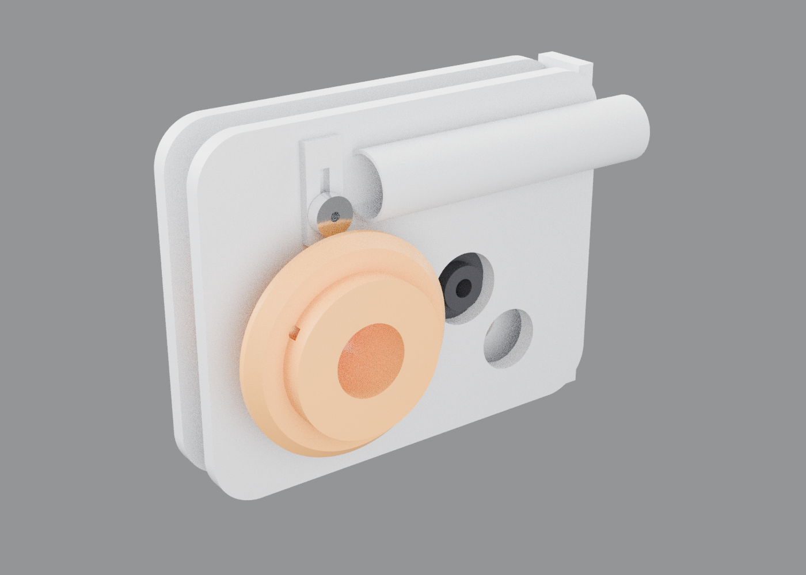

# Shoulder balancer (auto-generated by `python -m rnd.balancer`)

Zero-free-length cable-spring balancer. Pulley A sits 40–60 mm above the pitch axis in a slot; pin B sits on the balancer disc 20 mm from the axis, **along the arm**. A cable runs B → A → (2:1 tackle) → a caged die spring in the torso, giving τ = k·a·b·sin(pitch) at every angle. Precedent: the Anglepoise lamp, Herder's spring balancers, French & Widden cable balancers.

## Loop 47 (Astra #2b finding 8)

- **Pin-B sign: OK.** shoulder.py puts pin B at (0, -64, **-20**) mm in the module frame; the arm hangs along −Z. B must lie along the arm (−Z when hanging). Opposite the arm the torque is −k·a·b·sin(pitch): it doubles the gravity load instead of cancelling it, and the hanging span is a − b = 20 mm, not a + b = 80 mm (Astra's 20 vs 80 mm).
- **The 41 %:** at the old 65 mm slot end the spring deflection is (65 + 30)/2 = 47.5 mm = **41.3% of L0** (ISO green maximum 40 %; 35% at the nominal 50 mm, already over the 30 % medium-life line). Worse, the 12 N/mm spring the model assumed is not a catalogue part: the real green Ø25 × 115 is 18.7 N/mm, which makes the old geometry K = 7.0 N·m instead of 4.5 N·m.
- **Fix (this file):** keep the spring and the 2:1 tackle, change the geometry for the real rate: b = 20 mm, slot a = 40–60 mm. K = 4.5 N·m needs a = 48.1 mm.
- **Cable vs shaft:** a straight A–B cable passes within the Ø40 shaft for pitch 0–180° from hanging (both directions) whenever the balancer plane holds the shaft (loop 47 finding).
- **Fix (2026-11-27, CAD-checked): the balancer plane moved inboard of the shaft's inboard end** (y -63.5 mm in the module frame): an aluminium crank on the tube's inboard end face carries pin B, 4.2 mm past the crank face; pulley A sits in a double-shear fork on the inner wall, the spring cage runs back in the same plane. Solids the cable sweep zone meets (pin B and pulley A excluded): **none ✅**. Outboard of the tube end the hub → ferrule load path and the harness would both have to cross the plane on the axis, which the cable sweeps at pitch 0° and 180°; so the harness now crosses pitch through a clock spring outboard of the outer wall (shoulder.PITCH_SPR) and enters the hub bore through a side window.

| Quantity | Value |
|---|---|
| Spring (exact part) | ISO 10243 green (light load) die spring Ø25 hole / Ø12.5 rod × L0 115 mm, R 18.7 N/mm ± 10 % (Berger Tools V25-115; Accu TJL25-115) |
| Cable-side rate behind the 2:1 tackle, k = R/4 | **4.67 N/mm** |
| K at the nominal a = 48 mm | 4.49 N·m (design 4.5) |
| K adjustment by sliding A (40–60 mm) | 3.7–5.6 N·m; rate ± 10 % still reaches 4.5 N·m: a = 44–53 mm |
| Spring deflection, nominal (arm hanging) | 33.5 mm = 29% of L0 (medium life ≤ 30%) ✅ |
| Spring deflection at the slot end a = 60 mm | 40.0 mm = **35%** of L0 (ISO max 40%) ✅ |
| Spring force, nominal / slot end / ISO Fmax | 626 / 748 / 860 N |
| Stored energy (nominal, hanging) | 10.5 J |
| Cage: L0 + 12 ≤ 135 mm; bore Ø26.0 vs Ø25 spring hole | ✅; ✅ |
| B clears A at pitch 180° (|a − b| ≥ 15 mm over the slot) | ✅ (20 mm at the bottom of the slot) |
| Law error from the Ø24 mm pulley (max over −200…60°) | 1.12 N·m (25% of K) |
| Cable safety (2 mm UHMWPE, ESTIMATE 2000 N) | 6× |

Life: ISO 10243 green allows 25 % of L0 for long life, 30 % for medium life and 40 % at Fmax. The spring works between |a − b|/2 (arm up) and (a + b)/2 (arm hanging); most cycles are pitch 0 ↔ 90°, i.e. (a + b)/2 ↔ √(a² + b²)/2. Coupon C-bal: 10⁵ cycles at the slot end before the bulk buy.
Cable: B → pulley A (608-2Z in a Ø28 POM U-groove tyre, Ø8 axle in the fork) → moving tackle pulley (608-2Z in a 1 mm POM tyre, Ø24, in the Ø26 cage) → anchor screw on the cage. D/d at the cable ≈ 12 (was 5.5 on the U604).

**M8 (Fable review 2026-11-27): pulley bearings.** The tackle pulley carries 2 T (180° wrap), pulley A up to 2 T; T = half the spring force. Worst load P0 = 748 N (slot end). Static ratings: SKF catalogue C0 (deep-groove -2Z); s0 = C0 / P0, need ≥ 1.5 (SKF guideline 1–2 for slowly oscillating bearings, ESTIMATE).

| Bearing (d × D × B mm) | C0 (kN) | s0 at the slot end | |
|---|---|---|---|
| U604ZZ (wave 2) (4 × 13 × 4) | 0.28 | 0.37 | ❌ |
| 625-2Z (5 × 16 × 5) | 0.68 | 0.91 | ❌ |
| 626-2Z (6 × 19 × 6) | 0.95 | 1.27 | ❌ |
| 608-2Z (M8 choice) (8 × 22 × 7) | 1.37 | 1.83 | ✅ |

Pin-and-bushing pulleys (iglidur G on a Ø6 pin, 80 MPa static) would carry it too, but the bushing friction (μ ≈ 0.15 on r 3 vs the r 5.5 sheave) is ≈ ±16 % of the cable tension per pulley, a hysteresis band in the balancer law; the 608s keep it near zero.
**Detach hazard (A9):** with the arm off, the spring torque K·sin(pitch) is unopposed. Detach and attach only with the arm hanging (pitch 0, where the torque is zero), with the **park pin** in: a Ø6 pin through the bracket wall into a hole in the balancer disc at pitch 0. The pitch motor holds the shaft as well while powered.
**Failure mode:** with the cable cut, the arm is simply unbalanced; the pitch motor still holds it (see the workspace margins without the spring in spring.md).

