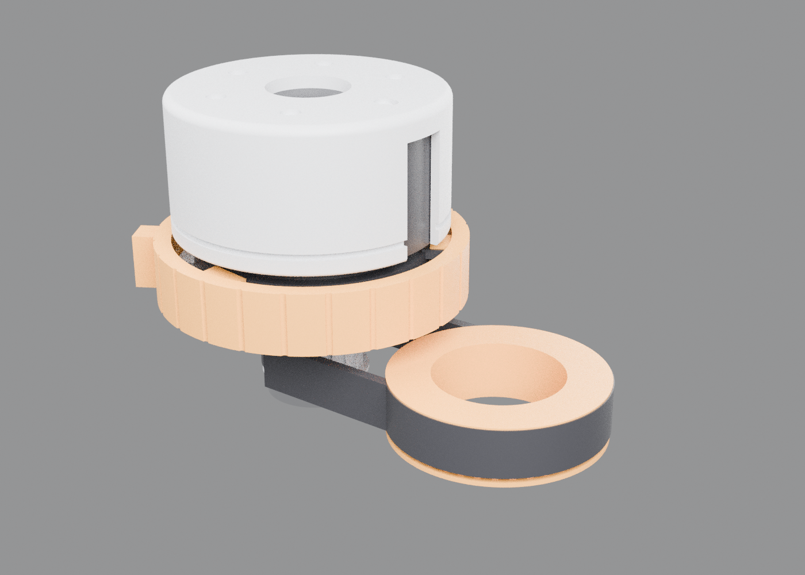

# Belt reductions (auto-generated by `python -m rnd.run_all`)

HTD 5M, 15 mm, printed pulleys, small pulley on its own bearing hub. **Loop 13 re-rating:** the 650 N/10 mm vendor figure used before is not a working rating. The checks now are: **sustained pull** (95th-percentile workspace holding torque, 1 kg) vs the **working tension 312 N** (Mädler neoprene 5M-15, the conservative published figure), and **peak pull** (actuator peak, short transients; the KX seat slips above it) vs **ultimate 3900 N / 3**. Precedent: Berkeley Blue's belt reductions.

| Joint | Teeth | Pitch Ø small / big | Sustained pull vs working | Peak pull vs ultimate/3 | Teeth in mesh | Centre / belt length |
|---|---|---|---|---|---|---|
| shoulder_pitch | 20:60 (3.00:1) | 31.8 / 95.5 | 194 / 312 N → 1.6× ✅ | 691 N → 5.6× ultimate ✅ | 7.0 ✅ | 70 / 354 mm |
| shoulder_roll | 18:80 (4.44:1) | 28.6 / 127.3 | 216 / 312 N → 1.4× ✅ | 768 N → 5.1× ultimate ✅ | 6.1 ✅ | 103.3 / 475 mm |
| upper_yaw | 20:40 (2.00:1) | 31.8 / 63.7 | 176 / 312 N → 1.8× ✅ | 691 N → 5.6× ultimate ✅ | 8.7 ✅ | 80 / 313 mm |
| elbow | 20:40 (2.00:1) | 31.8 / 63.7 | 205 / 312 N → 1.5× ✅ | 691 N → 5.6× ultimate ✅ | 8.5 ✅ | 70 / 294 mm |

- Belt lengths round to stock sizes; eccentric bushings set the tension (loop 10).
- If coupon tests show tooth jump or creep: switch to PU steel-cord HTD 5M (1268 N working, Mädler) at the same geometry, or to 25 mm belts.
- **Rejected (loop 3):** remote elbow motor on a long belt.

