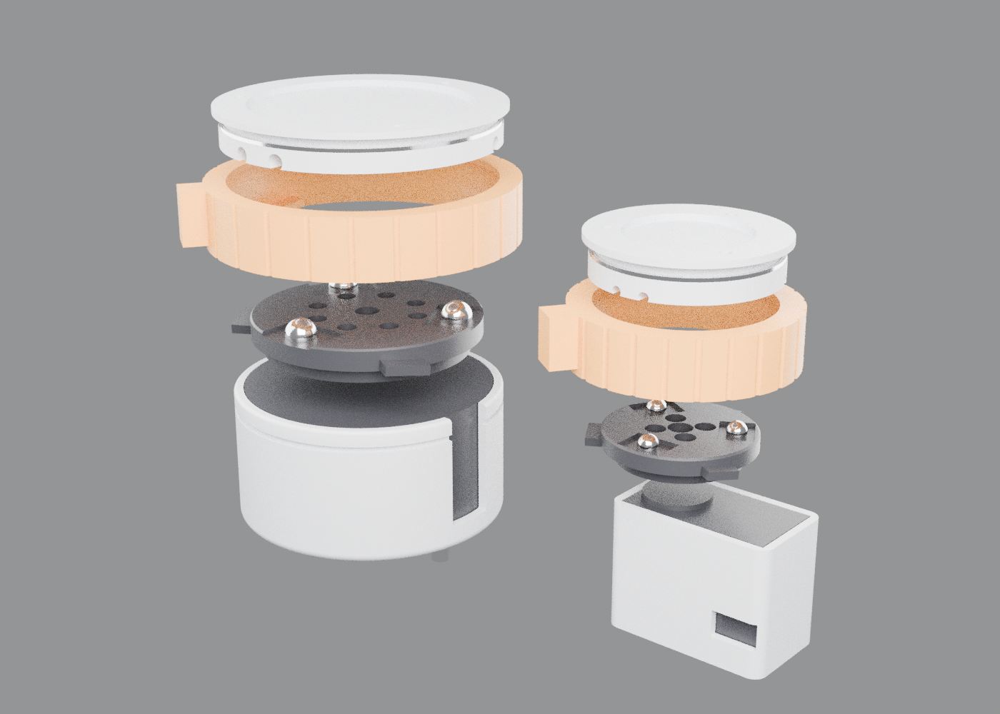

# KX joint interface v1: analysis (auto-generated by `python -m rnd.run_all`)

**Architecture.** A cartridge carries **torque only**. Its output face locks into a **hub** that turns in the bone's own bearing pair, and the motor housing is held by a **torque pin** in a radial slot (precedent: shaft-mounted gearboxes with a torque arm). Bending, axial and crash loads go through the bone's bearings, never through the printed interface or the motor's bearing.

**Seat.** 3 hardened balls on the cartridge; each sits on **two hardened dowel pins** in the hub (a ball on two rods: Maxwell coupling). A **breech-lock collar** with ramped teeth pulls the faces together, and a **spring stack** sets the preload (it rotates on a PTFE thrust washer).

**Design sweep (loop 2):** contact angle β 30° → 20° and balls Ø8 → Ø10 on Ø5 pins (KX74). The same 1.15× peak slip margin then needs 160 N of preload instead of 250 N. Twist effort drops from 4.2–6.3 to 2.1–2.7 N·m, and peak contact stress drops from 4,227 to ~3,550 MPa.

## Geometry

| Size | Flange OD | Ball / PCD | Pins | Contact angle β | Preload | Twist | Collar OD |
|---|---|---|---|---|---|---|---|
| KX74 | 74 | Ø10 / 58 | 6 × Ø5×14 | 20° | 160 N over a 1.0 mm stroke | 35° | 98 |
| KX56 | 56 | Ø8 / 43 | 6 × Ø4×11 | 20° | 140 N over a 1.0 mm stroke | 35° | 78 |
| KX44 | 44 | Ø6 / 31 | 6 × Ø3×8 | 20° | 80 N over a 1.0 mm stroke | 35° | 64 |

## Loads and stresses

| Interface + actuator | Rated / peak (N·m) | Slip torque | Ball-on-pin stress, rated / peak (limit 4,200 MPa) | Same ball in a **printed** groove, rated (PETG yield ~50 MPa) | Twist to lock, greased / dry | Lug shear / tooth bending (PETG) |
|---|---|---|---|---|---|---|
| KX74 + GIM6010-8 | 5.00 / 11.00 | 12.7 N·m ✅ | 3,226 / 3,554 MPa ✅ | 170 MPa ❌ (3× yield) | 2.1 / 2.7 N·m ✅ | 1.3 / 14 MPa |
| KX56 + DM-J4310-2EC_V1.1 | 3.00 / 7.00 | 8.3 N·m ✅ | 3,555 / 3,933 MPa ✅ | 188 MPa ❌ (4× yield) | 1.4 / 1.8 N·m ✅ | 1.7 / 17 MPa |
| KX44 + STS3215-C018 | 0.98 / 2.94 | 3.4 N·m ✅ | 3,506 / 3,966 MPa ✅ | 185 MPa ❌ (4× yield) | 0.6 / 0.8 N·m ✅ | 1.2 / 12 MPa |

## Socket bearings (one pair per socket)

| Socket | Interface | Bending moment (N·m) | Bearing pair | Max radial load per bearing | Static safety C0/P0 |
|---|---|---|---|---|---|
| shoulder_roll | KX74 | 14.4 | 2 × 61808 | 919 N | 4.0 ✅ |
| upper_yaw | KX74 | 12.2 | 2 × 61808 | 779 N | 4.7 ✅ |
| elbow | KX74 | 7.1 | 2 × 61808 | 452 N | 8.1 ✅ |
| wrist_pitch | KX56 | 1.8 | 2 × 61805 | 137 N | 19.0 ✅ |
| wrist_roll | KX44 | 1.2 | 2 × 61805 | 110 N | 23.6 ✅ |
| drive wheel | KX74 | 3.3 | 2 × 61808 | 261 N | 14.0 ✅ |

## Arm-detach coupling KX-V (loop 7)

The arm comes off at the shoulder-pitch output for carrying (D1). Unlike a joint cartridge, this plane carries the whole arm's bending, so it uses a **V-band clamp**: printed sanitary 3" flanges (stock stainless quick-release clamp fits), 3 steel dowels for location and torque, face contact over the full ring. Precedent: turbo / exhaust V-band joints, spacecraft Marman clamps, tri-clamp fittings.

| Check | Need (static × 1.5) | Capacity | |
|---|---|---|---|
| Bending (lift-off of the face ring) | 21.6 N·m | 40.0 N·m at 1000 N preload | 1.9× ✅ |
| Torque by face friction alone | 17.4 N·m | 10.0 N·m | 0.6× (dowels carry the rest: 7 MPa shear in Ø6 steel) |
| Flange bearing pressure | – | 0.9 MPa on printed PETG | ✅ |

The face is kinematically over-constrained (not a ball seat), so re-attachment repeats to ~0.05–0.1 mm (dowel fit), not microns. That's fine for an arm that re-homes from its absolute joint encoders; a camera check corrects any residual offset.

## Reading the numbers

- **Printed grooves fail.** A steel ball pressed into a printed V-groove at working load reaches several times PETG's yield. It would dent and creep, and the joint would lose its zero. **Dowel-pin grooves are the baseline**, not a fallback. Six Ø3–4 mm hardened pins plus three G25 balls per interface cost well under $1.
- **Slip torque is a feature.** With a defined preload the seat is a **ball-detent overload clutch**: it holds the actuator's peak torque, and beyond that it lets go before a printed bone breaks. It re-seats at the same position (kinematic). A slip past one ball pitch re-indexes by 120°, so the joint must re-home: v1 adds a magnet index in every hub for a Hall check (cartridge electronics item).
- **Ball-on-pin contact stress** stays under the bearing-steel static limit even at the actuators' absolute peak torque.
- **The twist effort is jar-lid territory (about 2–3 N·m).** That is why the collar has two thumb tabs and the ramp gets a smear of grease. Self-locking holds because the 6° ramp is below the friction angle (8.5° greased).
- **Socket bearings:** 61808 / 61805 thin-section pairs (~$2 each, ESTIMATE). Safety ≥ 2 everywhere under the conservative load case.

Assumptions marked ESTIMATE in `rnd/kx_check.py`; contact stresses use the R_eff = √(Ra·Rb) point-contact approximation.

