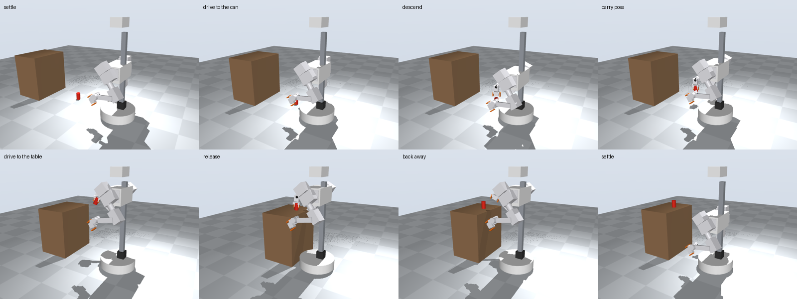

# Twin v1: dynamic fetch task (auto-generated by `python -m rnd.sim`)

Drive to a can on the floor → pick it top-down → drive to a table → place it → release → retract, in MuJoCo with **every actuator force-limited to its real peak** (joint = motor × belt × efficiency; base = 4 GIM omni wheels; lift = GIM on a 20T HTD pulley). Can 0.35 kg, Ø66 × 115 mm; table top 0.75 m.

**Result: ✅ can placed upright on the table** (final can position [1.56, -0.198, 0.807]). Robot–table contacts: 0 ✅.

| Actuator | Peak use / peak | RMS use / rated (continuous) |
|---|---|---|
| pitch_r | 9.0 / 31.3 (29%) | 5.3 / 14.2 (37%) |
| roll_r | 1.5 / 41.8 (4%) | 0.9 / 19.0 (5%) |
| yaw_r | 0.3 / 20.9 (1%) | 0.1 / 9.5 (2%) |
| elbow_r | 5.9 / 20.9 (28%) | 2.6 / 9.5 (27%) |
| wpitch_r | 1.0 / 7.0 (15%) | 0.3 / 3.0 (9%) |
| wroll_r | 0.0 / 2.9 (1%) | 0.0 / 1.0 (0%) |
| lift | 164.3 / 691.8 (24%) | 116.8 / 314.5 (37%) |
| base_x | 28.0 / 288.7 (10%) | 6.5 / 131.2 (5%) |
| base_y | 0.9 / 288.7 (0%) | 0.1 / 131.2 (0%) |
| fing_a_r | 50.0 / 150.0 (33%) | 30.5 / 50.0 (61%) |

**Dynamic tip margin (cart-table ZMP to the wheel polygon edge): min 75 mm** during "back away" at t = 19.5 s.

Video: [img/sim_fetch.mp4](img/sim_fetch.mp4)

## Robustness: perception error and object mass

The can is moved away from where the robot believes it is. *Open loop* trusts the belief. *Wrist camera* re-measures the can from above (Gaussian noise σ 3 mm, ESTIMATE) and re-plans the descent: the intended head-camera-coarse / wrist-camera-fine architecture.

| Can offset vs belief (mm) | Mass (kg) | Open loop | With wrist-camera correction |
|---|---|---|---|
| +15, +0 | 0.35 | ✅ | ✅ |
| -15, +0 | 0.35 | ✅ | ✅ |
| +0, +15 | 0.35 | ✅ | ✅ |
| +0, -15 | 0.35 | ✅ | ✅ |
| +0, +0 | 0.20 | ✅ | ✅ |
| +0, +0 | 0.60 | ✅ | ✅ |
| +10, +10 | 0.50 | ✅ | ✅ |
| -10, -10 | 0.50 | ✅ | ✅ |

**Open loop 8/8; with the wrist-camera correction 8/8.**