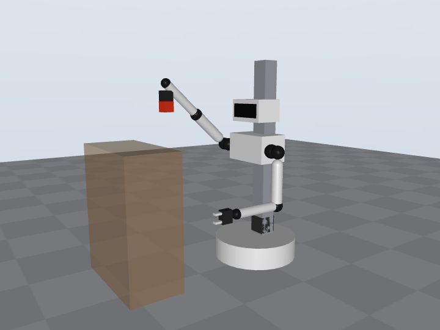

# Simulation twin: reach and tip-over (auto-generated by `python -m rnd.run_all`)

Model generated from `rnd/params.py`: arm 0.3+0.28+0.13 m, wrist ±140°, shoulder height 0.35–1.05 m, payload 1.0 kg in the right hand, left arm tucked. Reach = IK (lift + 6 joints) to within 1 cm and 20° of the required gripper direction. Grid: x = 0.30–0.65 m from the robot centre (base edge at 0.25 m), y across the right arm's side.

| Target | Reach coverage | Tip margin per layout (mm / max base accel m/s²) |
|---|---|---|
| floor pickup (z 0.03, gripper down) | 100% | X wheel-fwd R.21 (chosen): 71 / 2.6; X edge-fwd R.21: 71 / 2.6; kiwi R.21 (rejected): 39 / 1.4 |
| dishwasher low rack (z 0.20, down) | 94% | X wheel-fwd R.21 (chosen): 66 / 2.1; X edge-fwd R.21: 59 / 1.9; kiwi R.21 (rejected): 35 / 1.1 |
| table top (z 0.78, down) | 95% | X wheel-fwd R.21 (chosen): 66 / 1.5; X edge-fwd R.21: 59 / 1.3; kiwi R.21 (rejected): 35 / 0.8 |
| counter (z 0.95, down) | 95% | X wheel-fwd R.21 (chosen): 66 / 1.4; X edge-fwd R.21: 59 / 1.2; kiwi R.21 (rejected): 35 / 0.7 |
| shelf (z 1.20, horizontal) | 100% | X wheel-fwd R.21 (chosen): 74 / 1.4; X edge-fwd R.21: 73 / 1.4; kiwi R.21 (rejected): 41 / 0.8 |
| high shelf (z 1.40, horizontal) | 100% | X wheel-fwd R.21 (chosen): 82 / 1.4; X edge-fwd R.21: 84 / 1.5; kiwi R.21 (rejected): 46 / 0.8 |

