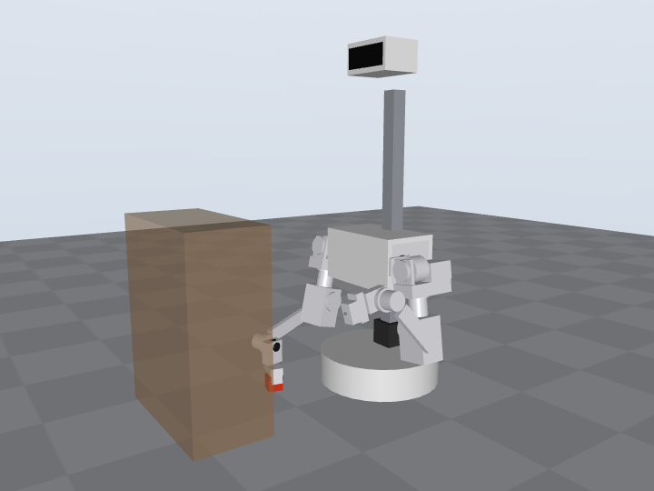

# Simulation twin: reach and tip-over (auto-generated by `python -m rnd.run_all`)

Model generated from `rnd/params.py`: arm 0.3+0.28+0.156 m, wrist ±120°, shoulder height 0.35–1.05 m, payload 1.0 kg in the right hand, left arm tucked. Reach = IK (lift + 6 joints) to within 1 cm and 20° of the required gripper direction. Grid: x = 0.30–0.65 m from the robot centre (base edge at 0.25 m), y across the right arm's side.

| Target | Reach coverage | Tip margin per layout (mm / max base accel m/s²) |
|---|---|---|
| counter, angled 45° grasp (z 0.95) | 96% | X wheel-fwd R.21 (chosen): 85 / 1.4; X edge-fwd R.21: 67 / 1.1; kiwi R.21 (rejected): 58 / 1.0 |
| floor pickup (z 0.03, gripper down) | 100% | X wheel-fwd R.21 (chosen): 84 / 2.2; X edge-fwd R.21: 67 / 1.8; kiwi R.21 (rejected): 56 / 1.5 |
| dishwasher low rack (z 0.20, down) | 95% | X wheel-fwd R.21 (chosen): 78 / 1.8; X edge-fwd R.21: 54 / 1.3; kiwi R.21 (rejected): 54 / 1.2 |
| table top (z 0.78, down) | 96% | X wheel-fwd R.21 (chosen): 84 / 1.3; X edge-fwd R.21: 62 / 1.0; kiwi R.21 (rejected): 57 / 0.9 |
| counter top-down only (z 0.95) [info: counters use top-down OR 45°, see D4b] | 62% | X wheel-fwd R.21 (chosen): 84 / 1.3; X edge-fwd R.21: 63 / 1.0; kiwi R.21 (rejected): 57 / 0.9 |
| shelf (z 1.20, horizontal) | 100% | X wheel-fwd R.21 (chosen): 94 / 1.5; X edge-fwd R.21: 76 / 1.2; kiwi R.21 (rejected): 65 / 1.0 |
| high shelf (z 1.40, horizontal) | 100% | X wheel-fwd R.21 (chosen): 97 / 1.4; X edge-fwd R.21: 84 / 1.2; kiwi R.21 (rejected): 65 / 0.9 |

## Two-handed tasks (shared lift, both arms, collision-free)

| Task | Feasible |
|---|---|
| hold a box at the table (hands 24 cm apart, z 0.85) | ✅ |
| hand-to-hand at chest height (handover) | ✅ |
| lift a box from the floor (hands 30 cm apart, z 0.10) | ✅ |
| fold a towel on the table (hands 40 cm apart, down, z 0.80) | ✅ |

